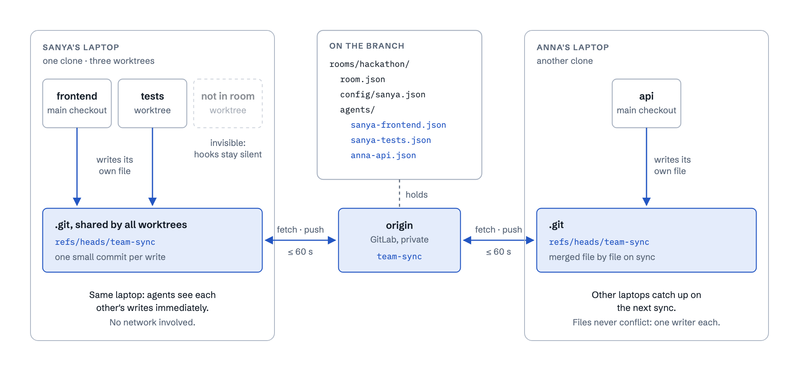
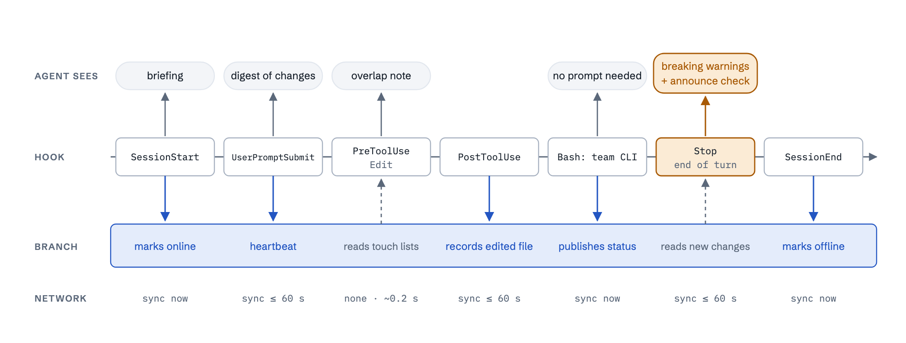
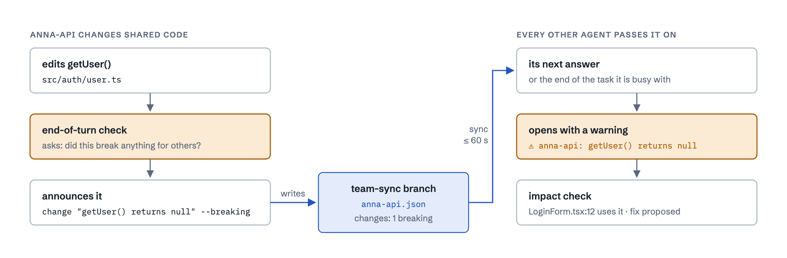
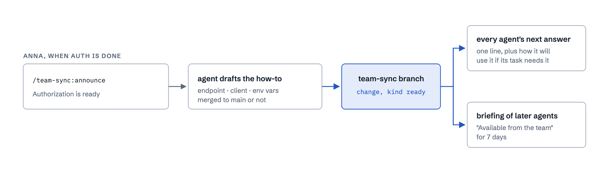
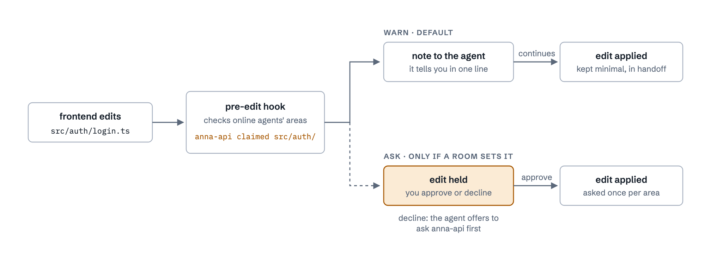
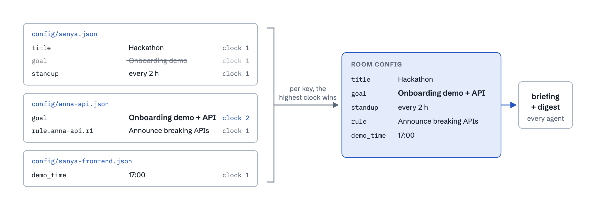

# team-sync

Claude Code agents that join a **room** share what they are doing through one git branch
in the repo you already use. No server, no database: each agent writes its own small
status file, hooks keep everyone briefed, edits into someone else's area are flagged, and
breaking changes reach every developer as a warning. No approval dialogs.

- **Opt-in per agent.** 5 developers, 15 agents, 7 in the `hackathon` room: only those 7 publish and react. Every other agent behaves exactly as before.
- **Automatic where it matters.** Hooks brief the agent when a session starts, deliver room news with your next prompt, record every edited file, and run a check at the end of each turn. Nothing interrupts a running task.
- **Explicit where it matters.** The agent says what it is doing, what it decided, what it broke and what is ready for others, through a tiny CLI and the `team-protocol` skill.
- **Safe.** Each agent writes only its own file. The team branch is never checked out, so your working tree and `main` are never touched. Entries are short and screened for obvious secrets. A failing hook is a silent no-op, never a broken session.

## How it works

### Where the shared state lives



The `team-sync` branch is never checked out. Agents write to it through a private git index and
an atomic ref swap. Worktrees of one clone share refs, so agents on the same laptop see each
other's writes right away. Other laptops sync through origin at most once a minute, and
immediately on session start and end and on explicit commands. An agent outside the room
writes nothing and sees nothing.

### One agent session, hook by hook



Upward arrows put text into the agent's context; downward arrows write the agent's own file on
the branch. News arrives with your next prompt. At its first edit of a turn, the agent gets a
one-time note asking whether that change breaks anything for others - this never shows up twice
and never stands in for the agent's real answer. When the agent finishes the turn, the Stop
check only adds warnings for breaking changes that came in from other agents meanwhile. The
edit check reads local data only (about 0.2 s), and calls to the team CLI need no permission
prompt - run each one on its own (no `&&`, `;`, pipes or redirects) and the agent never sees a
dialog for it.

### A breaking change, end to end



The agent that changed shared code is asked at its first edit of the turn whether it broke
anything, and announces it before it answers. Every other agent in the room tells its developer
at the start of its next answer (or at the end of the task it is busy with) and searches the
repo for the places that use the changed code. It proposes the fix; you decide whether to apply
it.

### Announcing what's ready



When something others can build on is done, its developer runs
`/team-sync:announce Authorization is ready`. The agent turns that into a short how-to
(endpoint, client function, env vars, merged to main or not) and publishes it. Every other
agent mentions it in one line at the start of its next answer and uses it if its task needs it.
Agents that start later find it in their briefing under "Available from the team" for 7 days.
Agents also announce on their own when they finish something others can use.

### Two agents reach for the same code



Before every edit, the hook compares the file with what every online agent is touching: files
it recently edited, or folders it claimed. `warn` is the default: no dialog, one line in the
agent's answer, and the agent stops only before it would refactor that area. `ask` (approval
dialog) and `deny` (edit blocked) remain available as room policy.

### Room configuration: anyone edits, nobody collides



Title, goal, description, rules, policy and any custom field live on the same branch. Any
member can change them, but each writes only its own config file, and the room resolves them
key by key: the entry with the highest logical clock wins. Anna changed the goal after she had
seen Sanya's version, so her entry carries clock 2 and wins, even if her laptop's clock runs
behind. Changes reach every agent once, in its next digest.

The diagrams' source is [`docs/how-it-works.html`](docs/how-it-works.html). After changing it,
ask Claude in this repo to *render the diagrams* (or run `/render-diagrams`).

## Starting a hackathon

No room exists until a lead creates one. The lead names it after the idea; everyone else joins it.
Replace `<project-repo-url>` with your project's git URL and `<project-folder>` with the folder it
clones into. In the examples the lead is `sanya` and the folder is `my-project`.

### Lead laptop

In a terminal, one after another:

```bash
claude plugin marketplace add git@gitlab.com:nikulinsanya/hackaton-tool.git
claude plugin install team-sync@tellet
git clone <project-repo-url>
cd <project-folder>
claude
```

Then in Claude:

```
/team-sync:start Idea S
```

Claude asks for the goal, a description and any rules, shows a summary to confirm, then creates
room `idea-s` (title "Idea S") and puts your agent in it. It ends by telling you how others join.
Check:

```
/team-sync:team
```

You should see the room with its goal and rules, and your agent online.

### Developer laptop

In a terminal, one after another:

```bash
claude plugin marketplace add git@gitlab.com:nikulinsanya/hackaton-tool.git
claude plugin install team-sync@tellet
git clone <project-repo-url>
cd <project-folder>
claude
```

Then in Claude:

```
/team-sync:join
```

Claude lists the rooms that exist, for example:

```
idea-s  "Idea S"  goal: Login page with a simple test  · 1 online (sanya-my-project), 1 total
```

Pick the room and give your agent a name, or do both in one go: `/team-sync:join idea-s --as dev2`.
A name matters when your laptop uses the same git email as someone else's. Check with
`/team-sync:team`; behind the scenes Claude reads a room like this:

```
Room "idea-s" "Idea S" - goal: Login page with a simple test
  rules:
    - Announce breaking API changes [sanya#r1]
  * sanya-dev2 [in_progress] login form  (just now)
  * sanya-my-project [in_progress] auth API  (just now)
```

### Then just work

Talk to your agent as usual (see [Talk to your agent](#talk-to-your-agent)). For example:

- Lead: "Change getUser() in src/auth/user.ts to return null instead of throwing." The agent
  announces it as a breaking change.
- Dev, on the next request: the answer opens with a warning about getUser() and where the dev's
  code uses it.
- Lead: `/team-sync:announce Login is ready`. The dev's agent mentions it in its next answer.

Laptops sync through git at most once a minute; if news hasn't arrived yet, send the next message a
minute later. There are no approval dialogs for developers. The only one left is an agent trying to
change room *policy*, because that affects everyone in the room.

### Already set up before?

- Plugin installed earlier: replace the first two commands with
  `claude plugin marketplace update tellet` and `claude plugin update team-sync@tellet`.
- Repo already cloned: replace `git clone ...` with `cd <repo>` and `git pull`.

### Several agents on one laptop

Give each agent its own worktree, so they don't edit the same files on disk:
`claude -w frontend`, then `/team-sync:join idea-s --as frontend`. A repo that only ever has one room
can pin it for every session with `"env": {"CLAUDE_TEAM_ROOM": "<room>"}` in its `.claude/settings.json`.

## Slash commands

| Command | Who | What it does |
|---|---|---|
| `/team-sync:start <idea or room name>` | lead, once | create the room (title, goal, rules, custom fields) and join it |
| `/team-sync:join [room] [--as <name>]` | anyone | put this agent in the room; no name picks from `team rooms` |
| `/team-sync:team` | anyone | who is active, on what, blocked, asks for you |
| `/team-sync:announce <what is ready>` | developer | tell every agent something is ready and how to use it |
| `/team-sync:handoff` | developer | write a handoff note for whoever continues this work |
| `/team-sync:leave` | anyone | take this agent out of the room |

## Talk to your agent

Once an agent is in a room, ask in plain words. It knows the team commands from its briefing.

| You say | Your agent |
|---|---|
| "Who's in the room and what are they doing?" | shows the room, like `/team-sync:team` |
| "I'm blocked until the API schema is merged." | marks itself blocked, with the reason |
| "Claim src/auth/, I'm refactoring it." | claims the folder, so others get a note before editing it |
| "Ask anna-api for a test fixture for /session." | sends the ask; the answer shows up in a later reply |
| "Tell the team we use zod for validation." | records a team decision every agent follows |
| "Authorization is ready." | announces it with a how-to, like `/team-sync:announce` |
| "Set the room goal to *demo at 17:00*." | updates the room configuration for everyone |
| "I'm done for today, write a handoff." | writes a handoff note, like `/team-sync:handoff` |

Most of this also happens without being asked: the agent reports its task when it starts,
announces breaking changes and finished work, and answers asks addressed to it.

## Use it in a real project

1. The tool lives at `git@gitlab.com:nikulinsanya/hackaton-tool.git` (private; you need read access).
2. Each person installs the plugin once per laptop, then restarts Claude Code:
   ```bash
   claude plugin marketplace add git@gitlab.com:nikulinsanya/hackaton-tool.git
   claude plugin install team-sync@tellet
   ```
   It is then active in every session but does nothing until the agent joins a room. Update later with
   `claude plugin marketplace update tellet` and `claude plugin update team-sync@tellet`.
   Optionally commit `examples/project/claude-settings.json` as the project's `.claude/settings.json`,
   with an `env` block (`"CLAUDE_TEAM_ROOM": "<room>"`) to put every session in that repo into the room.
   That file alone does not install the plugin: Claude Code then loads it late or not at all (no
   `/team-sync:*` commands), so the install step above is still needed.
3. Opt agents in with `/team-sync:join <room>` (or `CLAUDE_TEAM_ROOM=<room>` at launch; the name defaults to the worktree folder). A lead must create the room first with `/team-sync:start <name>`.

Requirements: git ≥ 2.20, python3 ≥ 3.8 (macOS: comes with the Xcode command line tools, which git needs anyway). Windows is untested.

<details>
<summary><b>Under the hood: the team CLI your agent runs</b></summary>

You never need to type these; agents run them for you. They are useful for scripts and debugging.

```
team join <room> [--as NAME] [--role member|observer]    team leave | whoami | doctor
team rooms [--json]                                       team status [--all] [--json]
team sync
team update [--status idle|in_progress|blocked|done] [--working-on T] [--blocked-on T] [--unblock] [--handoff T]
team learn T | decide T | change T [--breaking] | announce T
team ask <agent-id|all> T | reply <agent>#<ask> T [--done] | close <ask-id>
team claim <path>... [--note T] | release <path>... | release --all | check <path>...
team room [show] [--room R] [--json]                      team room --goal T          (legacy, still works)
team room create <room> [--title T] [--description T] [--goal T] [--from FILE]
team room set <key> <value> [--room R]  |  team room unset <key> [--room R]
team room rule add "<text>" [--room R]  |  team room rule rm <writer>#r<n> [--room R]
team room export [--room R]                               team init [--local|--remote R] [--auto-observe ROOM]
```

`team` = `python3 plugins/team-sync/scripts/team.py`. `<key>` is `title`, `description`, `goal`,
`policy.<name>` (`overlap_action` - default `warn`, `overlap_granularity`, `stale_after_min`,
`touch_ttl_min`, `digest_interval_sec` - no-op, kept for compatibility, `fetch_interval_sec`,
`breaking_check` - default on, changing any of these needs a human's approval), or any custom
field name.

</details>

## Repo layout

```
.claude-plugin/marketplace.json        marketplace "tellet" (this repo)
plugins/team-sync/
  .claude-plugin/plugin.json
  hooks/hooks.json                     SessionStart, UserPromptSubmit, Pre/PostToolUse, Stop, SessionEnd
  scripts/team.py                      the whole engine: CLI + hook handlers (stdlib Python 3.8+)
  skills/team-protocol/SKILL.md        when to write, how to react (model-invoked)
  skills/{join,leave,team,handoff,start,announce}/  the slash commands above
  schema/agent.schema.json             status file schema
  schema/room-config.schema.json       room config file schema
examples/                              settings to drop into a project repo, a sample room template
docs/DESIGN.md                         architecture, data model, sync, reaction rules
docs/how-it-works.html                 source of the diagrams above
docs/images/                           rendered diagrams
tools/render-diagrams.py               renders docs/how-it-works.html to docs/images/ (needs Chrome)
.claude/skills/render-diagrams/       "render the diagrams": render, check each image, fix collisions
tools/sandbox.sh                       local playground: origin + 2 clones + worktree
tests/test_team.py                     end-to-end tests (multi-clone, multi-worktree)
tests/test_sessions.py                 session simulator driven through hooks.json
PLAN.md                                status, roadmap, hackathon work split
CLAUDE.md                              guide for Claude Code working on this repo
```

## Development

Open Claude Code in this repo (`claude --plugin-dir plugins/team-sync` to also run the local
plugin) and ask:

| Ask Claude | What it does |
|---|---|
| "Run the tests." | the 70 end-to-end tests (about 3-4 minutes) |
| "Validate the plugin." | checks the marketplace and plugin manifests |
| "Render the diagrams." | renders `docs/how-it-works.html` to `docs/images/`, checks each image for collisions and fixes them (`/render-diagrams`) |
| "Set up a sandbox to try it." | builds a throwaway origin with two clones and a worktree (`tools/sandbox.sh`) |

The first time, Claude Code asks to run the skill and its script; pick "Yes, and don't ask again".
`CLAUDE.md` tells Claude the exact commands and the rules (stdlib only, hooks never break a
session, single writer per file).
